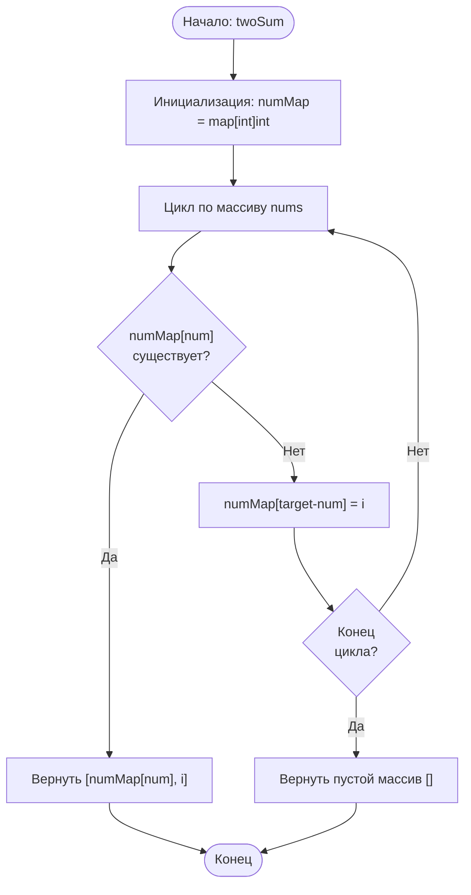

# 1. Two Sum

**Сумма двух чисел** · 🟢 Easy · Arrays & Hashing · [LeetCode](https://leetcode.com/problems/two-sum/description/)

## Условие

Дан массив целых чисел `nums` и целое число `target`. Верните *индексы двух чисел, сумма которых равна `target`*.

Можно считать, что у каждого набора входных данных есть ***ровно одно* решение**, и один и тот же элемент нельзя использовать *дважды*.

Ответ можно вернуть в любом порядке.

## Примеры

**Пример 1:**

```text
Input: nums = [2,7,11,15], target = 9
Output: [0,1]
Explanation: nums[0] + nums[1] = 2 + 7 = 9, поэтому возвращаем [0, 1].
```

**Пример 2:**

```text
Input: nums = [3,2,4], target = 6
Output: [1,2]
Explanation: nums[1] + nums[2] = 2 + 4 = 6, поэтому возвращаем [1, 2].
```

**Пример 3:**

```text
Input: nums = [3,3], target = 6
Output: [0,1]
Explanation: nums[0] + nums[1] = 3 + 3 = 6, поэтому возвращаем [0, 1].
```

## Ограничения

- `2 ≤ nums.length ≤ 10⁴`
- `-10⁹ ≤ nums[i] ≤ 10⁹`
- `-10⁹ ≤ target ≤ 10⁹`
- **Существует ровно одно верное решение.**

## Дополнительный вопрос

Можете ли вы придумать алгоритм, который работает быстрее, чем за `O(n²)`?

## Решение

Код — [main.go](main.go). Один проход с хеш-таблицей `numMap`: для каждого числа запоминаем, какое значение ему нужно в пару (`target - num`), вместе с его индексом. Если текущее число уже кто-то ждёт, ответ найден.

- Время: `O(n)`
- Память: `O(n)`


