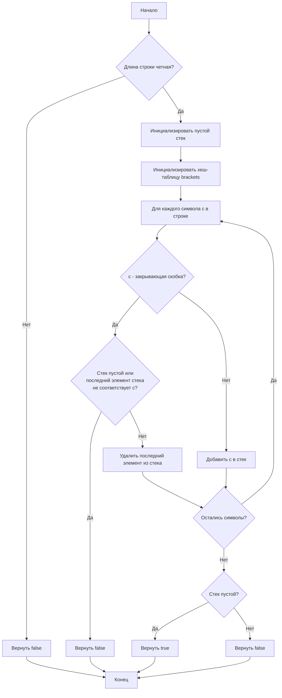

# 20. Valid Parentheses

**Валидные скобки** · 🟢 Easy · Stack · [LeetCode](https://leetcode.com/problems/valid-parentheses/description/)

## Условие

Дана строка `s`, содержащая только символы `'('`, `')'`, `'{'`, `'}'`, `'['` и `']'`. Определите, является ли входная строка допустимой.

Входная строка считается допустимой, если:

1. Открывающие скобки должны быть закрыты скобками того же типа.
2. Открывающие скобки должны быть закрыты в правильном порядке.
3. Каждая закрывающая скобка имеет соответствующую открывающую скобку того же типа.

## Примеры

**Пример 1:**

```text
Input: s = "()"
Output: true
```

**Пример 2:**

```text
Input: s = "()[]{}"
Output: true
```

**Пример 3:**

```text
Input: s = "(]"
Output: false
```

**Пример 4:**

```text
Input: s = "([])"
Output: true
```

**Пример 5:**

```text
Input: s = "([)]"
Output: false
```

## Ограничения

- `1 ≤ s.length ≤ 10⁴`
- `s` состоит только из скобок `'()[]{}'`.

## Решение

Код — [main.go](main.go). Строка нечётной длины сразу невалидна. Иначе открывающие скобки кладутся в стек, а для каждой закрывающей хеш-таблица `brackets` даёт парную открывающую: она должна лежать на вершине стека и тогда снимается. В конце стек должен оказаться пустым.

- Время: `O(n)`
- Память: `O(n)`


