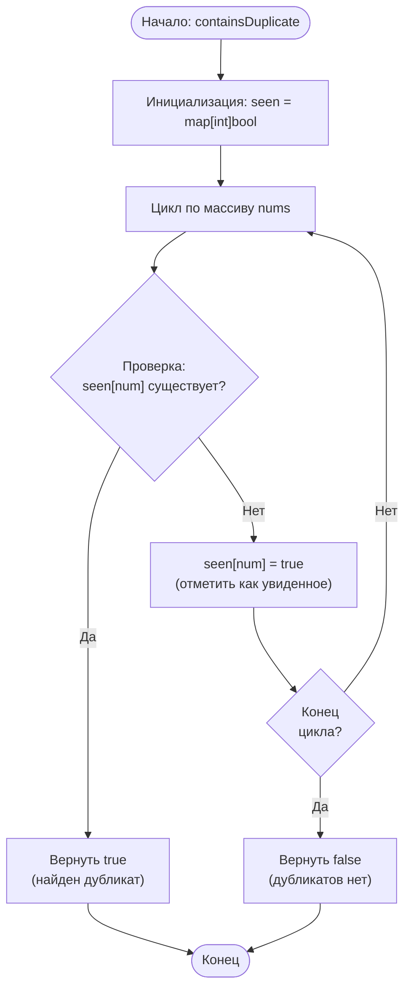

# 217. Contains Duplicate

**Содержит дубликат** · 🟢 Easy · Arrays & Hashing · [LeetCode](https://leetcode.com/problems/contains-duplicate/description/)

## Условие

Дан целочисленный массив `nums`. Верните `true`, если какое-либо значение встречается в массиве **хотя бы два раза**, и `false`, если все элементы массива уникальны.

## Примеры

**Пример 1:**

```text
Input: nums = [1,2,3,1]
Output: true
Explanation: элемент 1 встречается под индексами 0 и 3.
```

**Пример 2:**

```text
Input: nums = [1,2,3,4]
Output: false
Explanation: все элементы различны.
```

**Пример 3:**

```text
Input: nums = [1,1,1,3,3,4,3,2,4,2]
Output: true
```

## Ограничения

- `1 ≤ nums.length ≤ 10⁵`
- `-10⁹ ≤ nums[i] ≤ 10⁹`

## Решение

Код — [main.go](main.go). Один проход с хеш-таблицей `seen`: для каждого числа проверяем, встречалось ли оно раньше. Если да — дубликат найден, возвращаем `true`; иначе запоминаем число и идём дальше.

- Время: `O(n)`
- Память: `O(n)`


