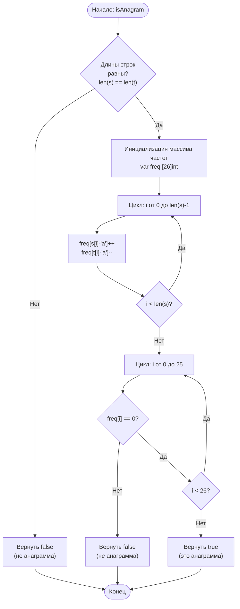

# 242. Valid Anagram

**Корректная анаграмма** · 🟢 Easy · Arrays & Hashing · [LeetCode](https://leetcode.com/problems/valid-anagram/description/)

## Условие

Даны две строки `s` и `t`. Верните `true`, если строка `t` является анаграммой строки `s`, и `false` в противном случае.

*Анаграмма* — это слово или фраза, образованные перестановкой букв другого слова или фразы, причём все исходные буквы используются ровно по одному разу.

## Примеры

**Пример 1:**

```text
Input: s = "anagram", t = "nagaram"
Output: true
```

**Пример 2:**

```text
Input: s = "rat", t = "car"
Output: false
```

## Ограничения

- `1 ≤ s.length, t.length ≤ 5 * 10⁴`
- `s` и `t` состоят только из строчных английских букв.

## Дополнительный вопрос

Что, если входные строки содержат символы Unicode? Как адаптировать решение для такого случая?

## Решение

Код — [main.go](main.go). Если длины строк различаются, сразу возвращаем `false`. Иначе за один проход считаем частоты букв в массиве `freq [26]int`: для буквы из `s` увеличиваем счётчик, для буквы из `t` — уменьшаем. Строки являются анаграммами, если в конце все счётчики равны нулю.

- Время: `O(n)`
- Память: `O(1)`


