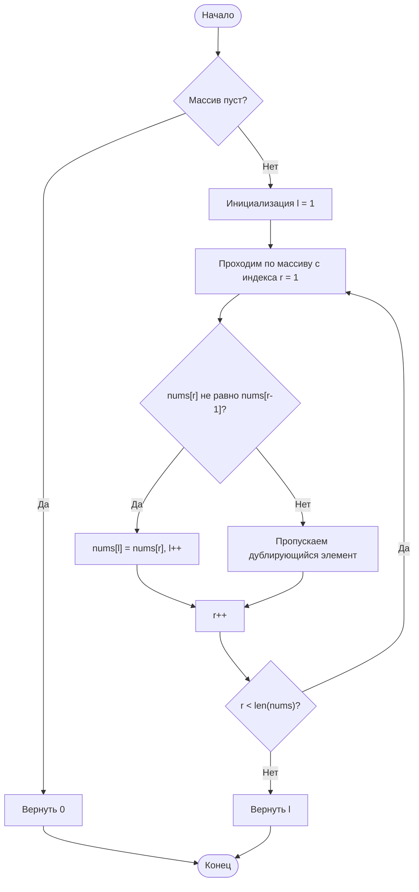

# 26. Remove Duplicates from Sorted Array

**Удаление дубликатов из отсортированного массива** · 🟢 Easy · Two Pointers · [LeetCode](https://leetcode.com/problems/remove-duplicates-from-sorted-array/description/)

## Условие

Дан целочисленный массив `nums`, отсортированный в **неубывающем порядке**. Удалите дубликаты [**на месте**](https://en.wikipedia.org/wiki/In-place_algorithm) так, чтобы каждый уникальный элемент встречался только **один раз**. **Относительный порядок** элементов должен остаться **прежним**.

Пусть `k` — количество *уникальных элементов* в `nums`. После удаления дубликатов верните количество уникальных элементов `k`.

Первые `k` элементов `nums` должны содержать уникальные числа в **отсортированном порядке**. Элементы после индекса `k - 1` можно не учитывать.

**Проверка решения (Custom Judge):**

Судья проверяет ваше решение следующим кодом:

```java
int[] nums = [...]; // Входной массив
int[] expectedNums = [...]; // Ожидаемый ответ правильной длины

int k = removeDuplicates(nums); // Вызов вашей реализации

assert k == expectedNums.length;
for (int i = 0; i < k; i++) {
    assert nums[i] == expectedNums[i];
}
```

Если все проверки пройдены, решение будет **принято**.

## Примеры

**Пример 1:**

```text
Input: nums = [1,1,2]
Output: 2, nums = [1,2,_]
Explanation: функция должна вернуть k = 2, а первые два элемента nums должны быть равны 1 и 2 соответственно.
Неважно, что останется после первых k элементов (поэтому они обозначены подчёркиваниями).
```

**Пример 2:**

```text
Input: nums = [0,0,1,1,1,2,2,3,3,4]
Output: 5, nums = [0,1,2,3,4,_,_,_,_,_]
Explanation: функция должна вернуть k = 5, а первые пять элементов nums должны быть равны 0, 1, 2, 3 и 4 соответственно.
Неважно, что останется после первых k элементов (поэтому они обозначены подчёркиваниями).
```

## Ограничения

- `1 ≤ nums.length ≤ 3 * 10⁴`
- `-100 ≤ nums[i] ≤ 100`
- `nums` отсортирован в **неубывающем** порядке.

## Решение

Код — [main.go](main.go). Два указателя: `r` просматривает массив, а `l` указывает на позицию, куда записать следующий уникальный элемент. Массив отсортирован, поэтому элемент уникален, если он отличается от предыдущего (`nums[r] != nums[r-1]`): тогда он копируется в `nums[l]`, и `l` сдвигается. В конце `l` равно количеству уникальных элементов.

- Время: `O(n)`
- Память: `O(1)`


