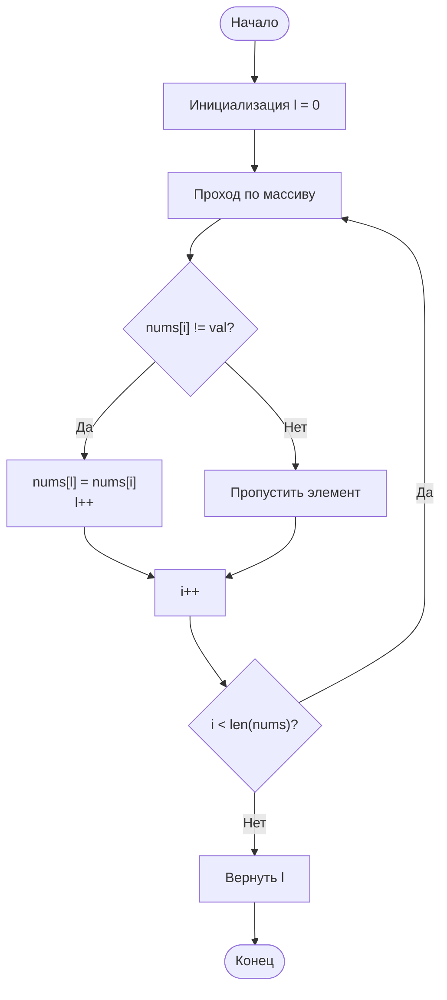

# 27. Remove Element

**Удаление элемента** · 🟢 Easy · Two Pointers · [LeetCode](https://leetcode.com/problems/remove-element/description/)

## Условие

Дан целочисленный массив `nums` и целое число `val`. Удалите все вхождения `val` в `nums` [**на месте**](https://en.wikipedia.org/wiki/In-place_algorithm). Порядок элементов может меняться. Затем верните *количество элементов в `nums`, которые не равны `val`*.

Пусть `k` — количество элементов в `nums`, не равных `val`. Чтобы решение было принято, нужно:

- Изменить массив `nums` так, чтобы первые `k` элементов `nums` содержали элементы, не равные `val`. Остальные элементы `nums`, как и размер `nums`, не важны.
- Вернуть `k`.

**Проверка решения (Custom Judge):**

Судья проверяет ваше решение следующим кодом:

```java
int[] nums = [...]; // Входной массив
int val = ...; // Значение, которое нужно удалить
int[] expectedNums = [...]; // Ожидаемый ответ правильной длины.
                            // Он отсортирован и не содержит значений, равных val.

int k = removeElement(nums, val); // Вызов вашей реализации

assert k == expectedNums.length;
sort(nums, 0, k); // Сортировка первых k элементов nums
for (int i = 0; i < actualLength; i++) {
    assert nums[i] == expectedNums[i];
}
```

Если все проверки пройдены, решение будет **принято**.

## Примеры

**Пример 1:**

```text
Input: nums = [3,2,2,3], val = 3
Output: 2, nums = [2,2,_,_]
Explanation: функция должна вернуть k = 2, а первые два элемента nums должны быть равны 2.
Неважно, что останется после первых k элементов (поэтому они обозначены подчёркиваниями).
```

**Пример 2:**

```text
Input: nums = [0,1,2,2,3,0,4,2], val = 2
Output: 5, nums = [0,1,4,0,3,_,_,_]
Explanation: функция должна вернуть k = 5, а первые пять элементов nums должны содержать 0, 0, 1, 3 и 4.
Обратите внимание, что эти пять элементов могут идти в любом порядке.
Неважно, что останется после первых k элементов (поэтому они обозначены подчёркиваниями).
```

## Ограничения

- `0 ≤ nums.length ≤ 100`
- `0 ≤ nums[i] ≤ 50`
- `0 ≤ val ≤ 100`

## Решение

Код — [main.go](main.go). Указатель `l` отмечает позицию, куда записать следующий элемент, не равный `val`. Индекс `i` проходит по массиву: каждый элемент `nums[i] != val` копируется в `nums[l]`, и `l` увеличивается, а элементы, равные `val`, пропускаются. В конце `l` равно количеству оставшихся элементов.

- Время: `O(n)`
- Память: `O(1)`


