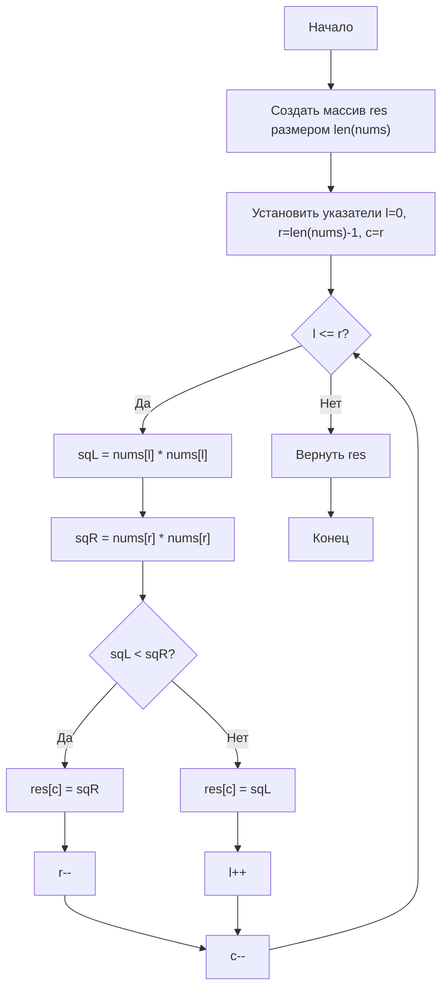

# 977. Squares of a Sorted Array

**Квадраты отсортированного массива** · 🟢 Easy · Two Pointers · [LeetCode](https://leetcode.com/problems/squares-of-a-sorted-array/description/)

## Условие

Дан целочисленный массив `nums`, отсортированный в **неубывающем** порядке. Верните *массив **квадратов каждого числа**, отсортированный в неубывающем порядке*.

## Примеры

**Пример 1:**

```text
Input: nums = [-4,-1,0,3,10]
Output: [0,1,9,16,100]
Explanation: после возведения в квадрат массив становится [16,1,0,9,100].
После сортировки он становится [0,1,9,16,100].
```

**Пример 2:**

```text
Input: nums = [-7,-3,2,3,11]
Output: [4,9,9,49,121]
```

## Ограничения

- `1 ≤ nums.length ≤ 10⁴`
- `-10⁴ ≤ nums[i] ≤ 10⁴`
- `nums` отсортирован в **неубывающем** порядке.

## Дополнительный вопрос

Возвести каждый элемент в квадрат и отсортировать новый массив — слишком тривиальное решение. Сможете ли вы найти решение за `O(n)`, используя другой подход?

## Решение

Код — [main.go](main.go). Два указателя `l` и `r` идут с концов массива: наибольший из оставшихся квадратов всегда находится на одном из краёв. На каждом шаге больший из квадратов `nums[l]` и `nums[r]` записывается в `res[c]` (индекс `c` заполняет результат с конца), а соответствующий указатель сдвигается к центру.

- Время: `O(n)`
- Память: `O(n)`



Схема решения: [977. Squares of a Sorted Array.excalidraw](977.%20Squares%20of%20a%20Sorted%20Array.excalidraw)
