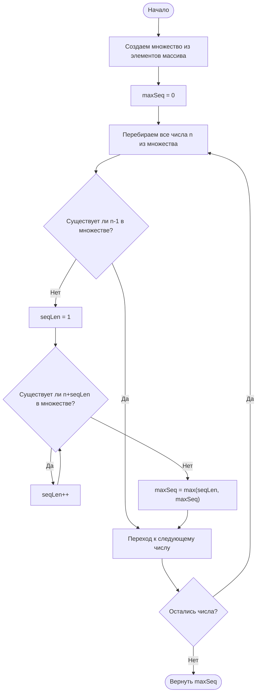

# 128. Longest Consecutive Sequence

**Самая длинная последовательность подряд идущих чисел** · 🟡 Medium · Arrays & Hashing · [LeetCode](https://leetcode.com/problems/longest-consecutive-sequence/description/)

## Условие

Дан несортированный массив целых чисел `nums`. Верните *длину самой длинной последовательности подряд идущих элементов*.

Вы должны написать алгоритм, который работает за время `O(n)`.

## Примеры

**Пример 1:**

```text
Input: nums = [100,4,200,1,3,2]
Output: 4
Explanation: самая длинная последовательность подряд идущих элементов — [1, 2, 3, 4]. Поэтому её длина равна 4.
```

**Пример 2:**

```text
Input: nums = [0,3,7,2,5,8,4,6,0,1]
Output: 9
```

**Пример 3:**

```text
Input: nums = [1,0,1,2]
Output: 3
```

## Ограничения

- `0 ≤ nums.length ≤ 10⁵`
- `-10⁹ ≤ nums[i] ≤ 10⁹`

## Решение

Код — [main.go](main.go). Складываем все числа в множество `numsSet`. Цепочку считаем только от числа `n`, для которого в множестве нет `n-1` (это начало последовательности), и идём вперёд, пока в множестве есть `n+seqLen`; ответ — максимальная длина `maxSeq` среди всех цепочек.

- Время: `O(N)`
- Память: `O(N)`


