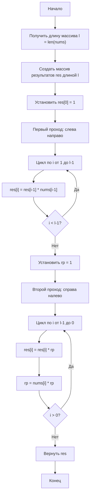

# 238. Product of Array Except Self

**Произведение элементов массива, кроме текущего** · 🟡 Medium · Arrays & Hashing · [LeetCode](https://leetcode.com/problems/product-of-array-except-self/description/)

## Условие

Дан целочисленный массив `nums`. Верните *массив* `answer`, *в котором* `answer[i]` *равен произведению всех элементов* `nums`, *кроме* `nums[i]`.

**Гарантируется**, что произведение любого префикса или суффикса массива `nums` помещается в **32-битное** целое число.

Вы должны написать алгоритм, который работает за время `O(n)` и не использует операцию деления.

## Примеры

**Пример 1:**

```text
Input: nums = [1,2,3,4]
Output: [24,12,8,6]
```

**Пример 2:**

```text
Input: nums = [-1,1,0,-3,3]
Output: [0,0,9,0,0]
```

## Ограничения

- `2 ≤ nums.length ≤ 10⁵`
- `-30 ≤ nums[i] ≤ 30`
- Входные данные сгенерированы так, что `answer[i]` **гарантированно** помещается в **32-битное** целое число.

## Дополнительный вопрос

Сможете ли вы решить задачу, используя `O(1)` дополнительной памяти? (Выходной массив **не считается** дополнительной памятью при анализе сложности по памяти.)

## Решение

Код — [main.go](main.go). Первым проходом слева направо записываем в `res[i]` произведение всех элементов левее `i`. Вторым проходом справа налево домножаем `res[i]` на произведение всех элементов правее `i`, которое накапливаем в переменной `rp`; деление не используется.

- Время: `O(N)`
- Память: `O(N)` — это сам выходной массив, дополнительная память `O(1)`



Схема решения: [238. Product of Array Except Self.excalidraw](238.%20Product%20of%20Array%20Except%20Self.excalidraw)
