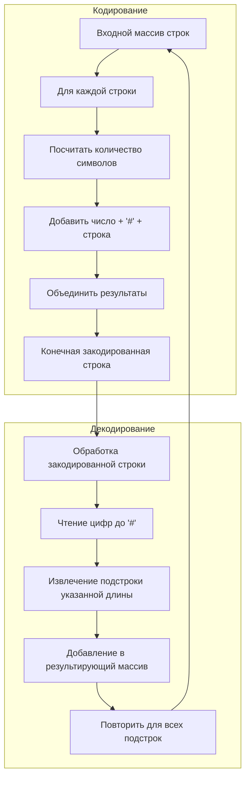

# 271. Encode and Decode Strings

**Кодирование и декодирование строк** · 🟡 Medium · Arrays & Hashing · [LeetCode 🔒](https://leetcode.com/problems/encode-and-decode-strings/description/) · [LintCode 659](https://www.lintcode.com/problem/659/)

## Условие

Разработайте алгоритм, который кодирует **список строк** в **одну строку**. Закодированная строка передаётся по сети, а затем декодируется обратно в исходный список строк.

На машине 1 (отправитель) есть функция:

```cpp
string encode(vector<string> strs) {
  // ... ваш код
  return encoded_string;
}
```

На машине 2 (получатель) есть функция:

```cpp
vector<string> decode(string s) {
  // ... ваш код
  return strs;
}
```

Таким образом, машина 1 выполняет:

```cpp
string encoded_string = encode(strs);
```

а машина 2 выполняет:

```cpp
vector<string> strs2 = decode(encoded_string);
```

Список `strs2` на машине 2 должен совпадать со списком `strs` на машине 1.

Реализуйте методы `encode` и `decode`.

Решать задачу с помощью каких-либо методов сериализации (например, `eval`) нельзя.

## Примеры

**Пример 1:**

```text
Input: dummy_input = ["Hello","World"]
Output: ["Hello","World"]
Explanation:
Машина 1:
Codec encoder = new Codec();
String msg = encoder.encode(strs);
Машина 1 ---msg---> Машина 2

Машина 2:
Codec decoder = new Codec();
String[] strs = decoder.decode(msg);
```

**Пример 2:**

```text
Input: dummy_input = [""]
Output: [""]
```

## Ограничения

- `1 ≤ strs.length ≤ 200`
- `0 ≤ strs[i].length ≤ 200`
- `strs[i]` может содержать любые из `256` допустимых символов ASCII.

## Дополнительный вопрос

Сможете ли вы написать обобщённый алгоритм, который работает с любым возможным набором символов?

## Решение

Код — [main.go](main.go). `encodeString` записывает перед каждой строкой её длину в символах (рунах) и разделитель `#`, например `4#code`. `decodeString` читает цифры до `#`, получает длину и забирает столько следующих символов как очередную строку.

- Время: `O(n)`
- Память: `O(n)`

**Рекомендуемая сложность (NeetCode):** `O(m)` по времени для каждого вызова `encode()` и `decode()` и `O(m + n)` по памяти, где `m` — сумма длин всех строк, а `n` — количество строк.


