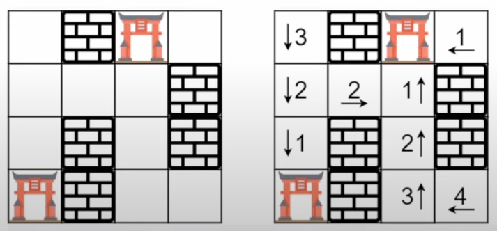

# 286. Walls and Gates

**Стены и ворота** · 🟡 Medium · Graphs · [LeetCode 🔒](https://leetcode.com/problems/walls-and-gates/description/) · [LintCode 663](https://www.lintcode.com/problem/663/)

## Условие

Дана сетка `rooms` размером `m x n`, инициализированная тремя возможными значениями:

- `-1` — стена или препятствие.
- `0` — ворота.
- `INF` — бесконечность, означает пустую комнату. Для `INF` используется значение `2³¹ - 1 = 2147483647`, так как можно считать, что расстояние до ворот меньше `2147483647`.

Заполните каждую пустую комнату расстоянием до *ближайших к ней ворот*. Если добраться до ворот невозможно, комната должна быть заполнена значением `INF`.

## Примеры

**Пример 1:**



```text
Input: rooms = [[2147483647,-1,0,2147483647],[2147483647,2147483647,2147483647,-1],[2147483647,-1,2147483647,-1],[0,-1,2147483647,2147483647]]
Output: [[3,-1,0,1],[2,2,1,-1],[1,-1,2,-1],[0,-1,3,4]]
```

**Пример 2:**

```text
Input: rooms = [[-1]]
Output: [[-1]]
```

## Ограничения

- `m == rooms.length`
- `n == rooms[i].length`
- `1 ≤ m, n ≤ 250`
- `rooms[i][j]` равно `-1`, `0` или `2³¹ - 1`.
