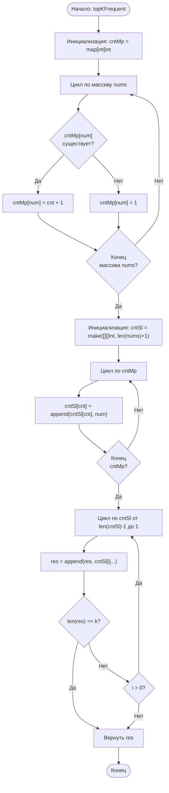

# 347. Top K Frequent Elements

**Топ K частых элементов** · 🟡 Medium · Arrays & Hashing · [LeetCode](https://leetcode.com/problems/top-k-frequent-elements/description/)

## Условие

Дан целочисленный массив `nums` и целое число `k`. Верните *`k` наиболее часто встречающихся элементов*. Ответ можно вернуть в **любом порядке**.

## Примеры

**Пример 1:**

```text
Input: nums = [1,1,1,2,2,3], k = 2
Output: [1,2]
```

**Пример 2:**

```text
Input: nums = [1], k = 1
Output: [1]
```

**Пример 3:**

```text
Input: nums = [1,2,1,2,1,2,3,1,3,2], k = 2
Output: [1,2]
```

## Ограничения

- `1 ≤ nums.length ≤ 10⁵`
- `-10⁴ ≤ nums[i] ≤ 10⁴`
- `k` находится в диапазоне `[1, количество уникальных элементов в массиве]`.
- **Гарантируется**, что ответ **единственный**.

## Дополнительный вопрос

Временная сложность вашего алгоритма должна быть лучше, чем `O(n log n)`, где `n` — размер массива.

## Решение

Код — [main.go](main.go). Считаем частоту каждого числа в хеш-таблице `cntMp`, затем раскладываем числа по «корзинам» `cntSl`, где индекс — это частота (блочная сортировка, bucket sort). Проходим по корзинам от большей частоты к меньшей и добавляем числа в ответ, пока не наберётся `k` элементов.

- Время: `O(N)`
- Память: `O(N)`


