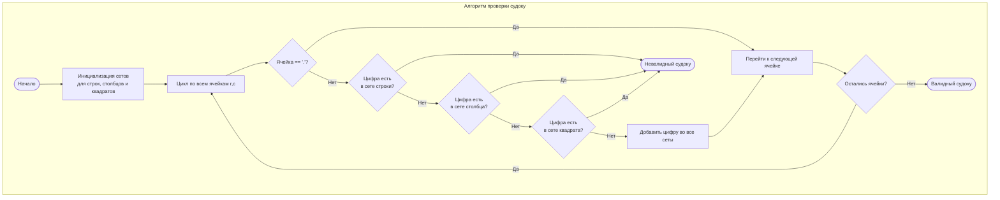

# 36. Valid Sudoku

**Корректный судоку** · 🟡 Medium · Arrays & Hashing · [LeetCode](https://leetcode.com/problems/valid-sudoku/description/)

## Условие

Определите, является ли доска судоку размером `9 x 9` корректной. Проверить нужно только заполненные ячейки **согласно следующим правилам**:

1. Каждая строка должна содержать цифры `1-9` без повторений.
2. Каждый столбец должен содержать цифры `1-9` без повторений.
3. Каждый из девяти подквадратов `3 x 3` сетки должен содержать цифры `1-9` без повторений.

**Примечание:**

- Доска судоку (частично заполненная) может быть корректной, но не обязательно решаемой.
- Проверять нужно только заполненные ячейки в соответствии с перечисленными правилами.

## Примеры

**Пример 1:**


```text
Input: board =
[["5","3",".",".","7",".",".",".","."]
,["6",".",".","1","9","5",".",".","."]
,[".","9","8",".",".",".",".","6","."]
,["8",".",".",".","6",".",".",".","3"]
,["4",".",".","8",".","3",".",".","1"]
,["7",".",".",".","2",".",".",".","6"]
,[".","6",".",".",".",".","2","8","."]
,[".",".",".","4","1","9",".",".","5"]
,[".",".",".",".","8",".",".","7","9"]]
Output: true
```

**Пример 2:**

```text
Input: board =
[["8","3",".",".","7",".",".",".","."]
,["6",".",".","1","9","5",".",".","."]
,[".","9","8",".",".",".",".","6","."]
,["8",".",".",".","6",".",".",".","3"]
,["4",".",".","8",".","3",".",".","1"]
,["7",".",".",".","2",".",".",".","6"]
,[".","6",".",".",".",".","2","8","."]
,[".",".",".","4","1","9",".",".","5"]
,[".",".",".",".","8",".",".","7","9"]]
Output: false
Explanation: то же, что и в примере 1, но 5 в левом верхнем углу заменена на 8. Поскольку в левом верхнем подквадрате 3x3 теперь две восьмёрки, доска некорректна.
```

## Ограничения

- `board.length == 9`
- `board[i].length == 9`
- `board[i][j]` — цифра `1-9` или `'.'`.

## Решение

Код — [main.go](main.go). Заводим по девять множеств (`map[byte]struct{}`) для строк, столбцов и подквадратов 3×3. Для каждой заполненной ячейки проверяем, нет ли её цифры в множестве её строки, столбца или подквадрата (индекс `(r/3)*3 + c/3`): если есть, доска некорректна, иначе добавляем цифру во все три множества.

- Время: `O(1)` — доска всегда размером 9×9
- Память: `O(1)`


