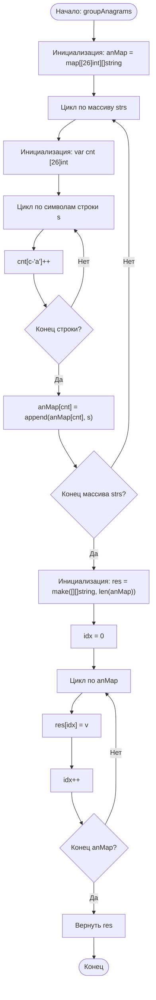

# 49. Group Anagrams

**Группировка анаграмм** · 🟡 Medium · Arrays & Hashing · [LeetCode](https://leetcode.com/problems/group-anagrams/description/)

## Условие

Дан массив строк `strs`. Сгруппируйте анаграммы вместе. Ответ можно вернуть в **любом порядке**.

*Анаграмма* — это слово или фраза, образованные перестановкой букв другого слова или фразы, причём все исходные буквы используются ровно по одному разу.

## Примеры

**Пример 1:**

```text
Input: strs = ["eat","tea","tan","ate","nat","bat"]
Output: [["bat"],["nat","tan"],["ate","eat","tea"]]
Explanation:
- В strs нет строки, из которой перестановкой букв можно получить "bat".
- Строки "nat" и "tan" — анаграммы: их можно получить друг из друга перестановкой букв.
- Строки "ate", "eat" и "tea" — анаграммы: их можно получить друг из друга перестановкой букв.
```

**Пример 2:**

```text
Input: strs = [""]
Output: [[""]]
```

**Пример 3:**

```text
Input: strs = ["a"]
Output: [["a"]]
```

## Ограничения

- `1 ≤ strs.length ≤ 10⁴`
- `0 ≤ strs[i].length ≤ 100`
- `strs[i]` состоит только из строчных английских букв.

## Решение

Код — [main.go](main.go). Для каждой строки считаем частоты букв в массиве `[26]int` и используем этот массив как ключ хеш-таблицы `anMap`: у анаграмм частоты совпадают, поэтому они попадают в одну группу. В конце переносим группы из таблицы в результирующий срез.

- Время: `O(N * K)`, где `N` — количество строк, `K` — максимальная длина строки
- Память: `O(N * K)`



Схема решения: [49. Group Anagrams.excalidraw](49.%20Group%20Anagrams.excalidraw)
